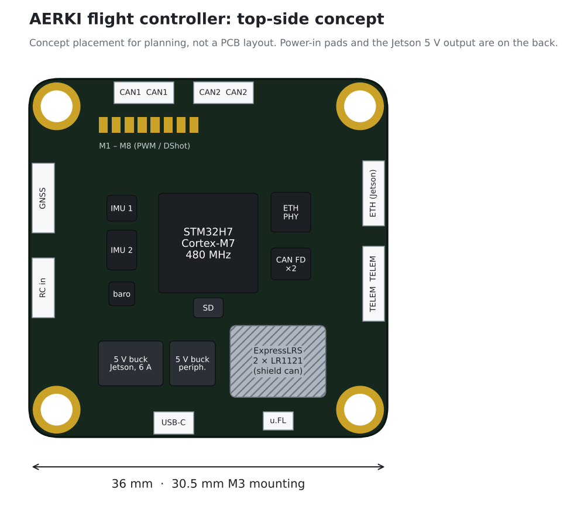
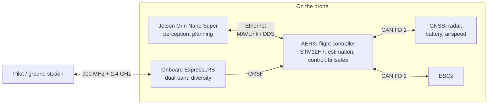
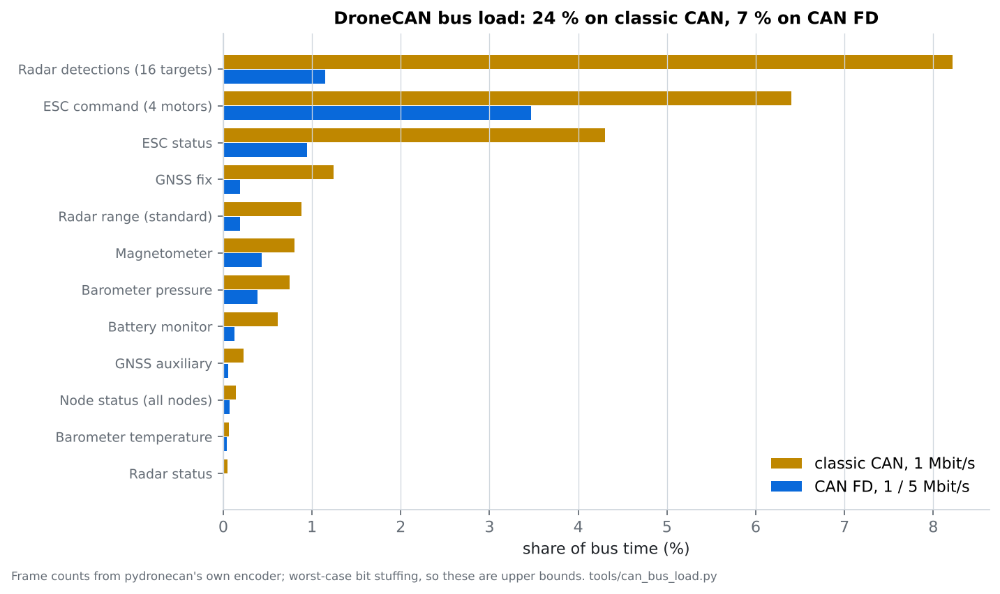
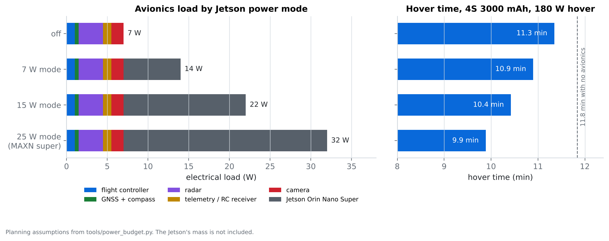

# AI-Flight-Controller

A compact flight controller for small drones, built to pair with an onboard AI computer and a DroneCAN
peripheral ecosystem.

[](https://github.com/aerki-space/AI-Flight-Controller/actions/workflows/ci.yml)

<p align="center"></p>

> **Status:** In active development. Hardware design files, firmware and validation results will be
> published as they are completed. Specifications below are design targets and may change.

## Key specifications

| | |
|---|---|
| Processor | STM32H7 (Cortex-M7, 480 MHz); custom SoC planned for future revisions |
| Sensors | Dual redundant IMUs, barometer |
| RC link | Integrated nano ExpressLRS receiver: dual-band (900 MHz + 2.4 GHz), true diversity, telemetry |
| AI companion | NVIDIA Jetson Orin Nano Super, via Ethernet and UART |
| Peripherals | DroneCAN over CAN FD (2 buses) |
| Firmware | ArduPilot (primary), PX4 |
| Form factor | 36 × 36 mm, 30.5 mm mounting pattern |
| Input power | 2S – 6S |

## Two computers, one job each



- **The flight controller flies the drone.** Estimation, control and failsafes run on the STM32H7 and never wait on
  the AI computer. If the Jetson stops talking, the drone holds, returns or lands, as configured.
- **The Jetson decides where to go.** It runs perception (see
  [Edge-Perception](https://github.com/aerki-space/Edge-Perception)) and sends bounded setpoints and missions. It
  never drives the motors.
- **Everything else is on DroneCAN.** Two CAN FD buses keep the propulsion separate from the sensors, so a faulty
  sensor can't block motor commands.

## Bus load

A full sensor suite, including the [phased-array radar](https://github.com/aerki-space/Drone-Can-Radar) publishing
16 targets at 20 Hz, uses about a quarter of a classic CAN bus. On CAN FD it uses 7 %, leaving room for more
payloads.



## Power and flight time

The Jetson is the largest electrical load after the motors. Its power mode is chosen per mission: a full 25 W
costs about 2 minutes of hover on a 4S 3000 mAh drone.



## Repository layout

```
docs/
  architecture.md   system overview, interfaces and power
  companion.md      pairing with the Jetson Orin Nano Super
  dronecan.md       CAN buses, peripherals, bus load, radar integration
  firmware.md       ArduPilot / PX4 / INAV / custom: comparison and plan
hardware/
  README.md         board outline, connectors, power tree
tools/
  can_bus_load.py   DroneCAN bus-load estimate (classic CAN vs CAN FD)
  power_budget.py   avionics power and hover-time impact
  plot_figures.py   regenerates docs/img
tests/              checks for the tools
```

## Quick start

```sh
pip install -r tools/requirements.txt
python3 tools/can_bus_load.py
python3 tools/power_budget.py
python3 tools/plot_figures.py
python3 -m unittest discover -s tests
```

## Roadmap

- Hardware design files
- ArduPilot board port
- Companion-computer integration guide
- Test and validation results
- Next-generation revision on a custom SoC

More details coming soon.

## License

MIT, see [LICENSE](LICENSE).
