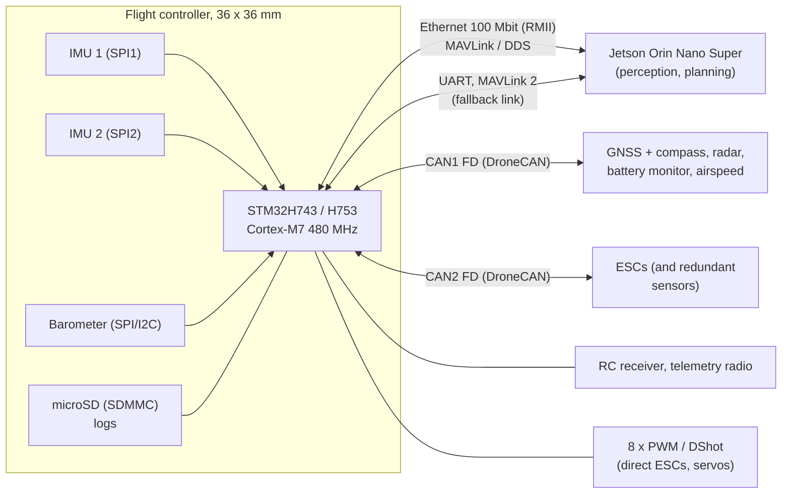

# Architecture

## System overview

The STM32H7 runs the flight stack: estimation, control and failsafes. It must keep flying safely whatever the
companion computer does. The Jetson runs perception and high-level autonomy, and sends setpoints and missions to the
flight controller. It never drives the motors directly.

## Processor

**STM32H743 or H753 (Cortex-M7, 480 MHz, 2 MB flash, 1 MB RAM).** It's the established MCU for current flight
controllers, and both ArduPilot and PX4 support it well. It provides everything this board needs:
- two FDCAN controllers;
- an Ethernet MAC;
- SDMMC for logging;
- USB;
- up to 8 UARTs.

The H753 adds a crypto/hash accelerator, useful for secure boot and signed firmware.

## Sensors

| Function | Plan |
|---|---|
| IMUs | Two different parts on separate SPI buses (for example ICM-42688-P and BMI088), so one failure mode can't take out both. Soft-mounted, with an optional heater for cold starts. |
| Barometer | One onboard (for example DPS310 or BMP390) under foam, shielded from prop wash and light |
| Compass | External, inside the DroneCAN GNSS module, away from power wiring. Onboard compass optional. |

## Interface allocation (MCU peripherals)

| Peripheral | Use |
|---|---|
| FDCAN1 | DroneCAN bus 1: GNSS / compass, radar, battery monitor, airspeed |
| FDCAN2 | DroneCAN bus 2: ESCs, redundant sensors |
| ETH (RMII) | Jetson link: MAVLink and/or DDS (ROS 2) |
| UART × 2 | Jetson fallback link; telemetry radio |
| UART × 2 | RC receiver (CRSF / SBUS); spare GNSS |
| UART × 2 | Spare (ESC telemetry, rangefinder, ADS-B) |
| SPI1 / SPI2 | IMU 1 / IMU 2 |
| SPI3 or I2C | Barometer |
| I2C | External compass / airspeed (non-CAN parts) |
| SDMMC | microSD logging |
| TIM | 8 × PWM / DShot outputs |
| ADC | Analog battery voltage / current (fallback to the DroneCAN monitor) |
| USB | Configuration, firmware updates, MAVLink |

## Power

- **Input:** 2S – 6S (7 – 26 V).
- **Board supply:** the flight controller runs from its own regulator, and can also be powered from USB on the
  bench. Peripherals get a separate 5 V supply, so a short on a peripheral can't reset the flight controller.
- **Jetson supply:** a dedicated 5 V supply, sized for the Jetson module's peak draw, on a separate connector.
  Confirm the input voltage and current against NVIDIA's module datasheet before the schematic.

From `python3 tools/power_budget.py`, on a 4S 3000 mAh airframe hovering at about 180 W:

| Jetson mode | Avionics load | Hover time lost (vs. no avionics) |
|---|---|---|
| Off | 7 W | ~0.5 min |
| 7 W | 14 W | ~0.9 min |
| 15 W | 22 W | ~1.4 min |
| 25 W (MAXN super) | 32 W | ~2.0 min |

These figures don't include the Jetson's mass (module, carrier and heatsink), which raises hover power. Pick the
Jetson power mode per mission, rather than leaving it at maximum.

## Safety principles

1. The flight controller never depends on the companion for stable flight. Losing the companion link triggers a
   configured failsafe (hold, return or land).
2. Setpoints from the companion are rate-limited and bounded by the flight controller's own limits (fence, speed,
   altitude).
3. The two DroneCAN buses separate the propulsion (ESCs) from the sensors, so a fault or babbling node on one bus
   can't stop the motors from receiving commands.
